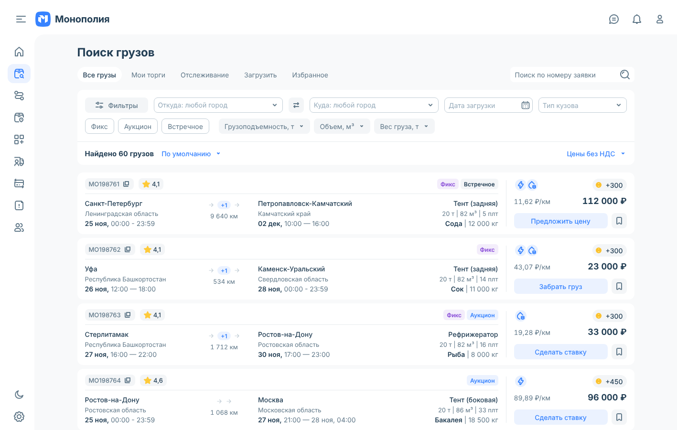
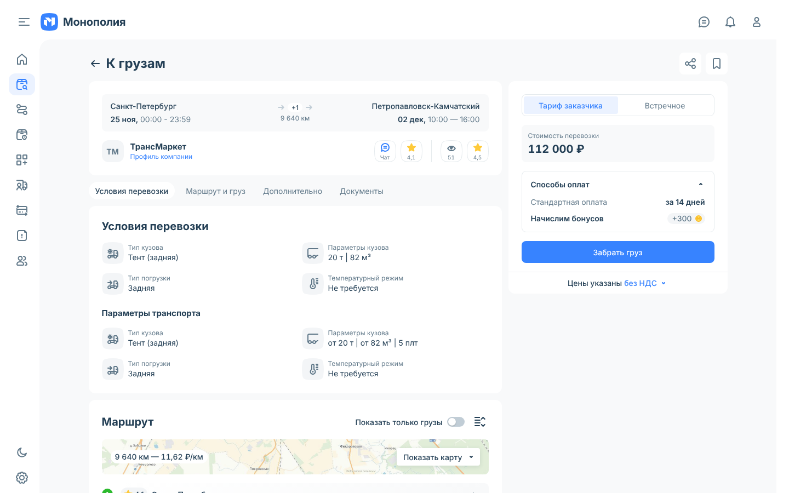
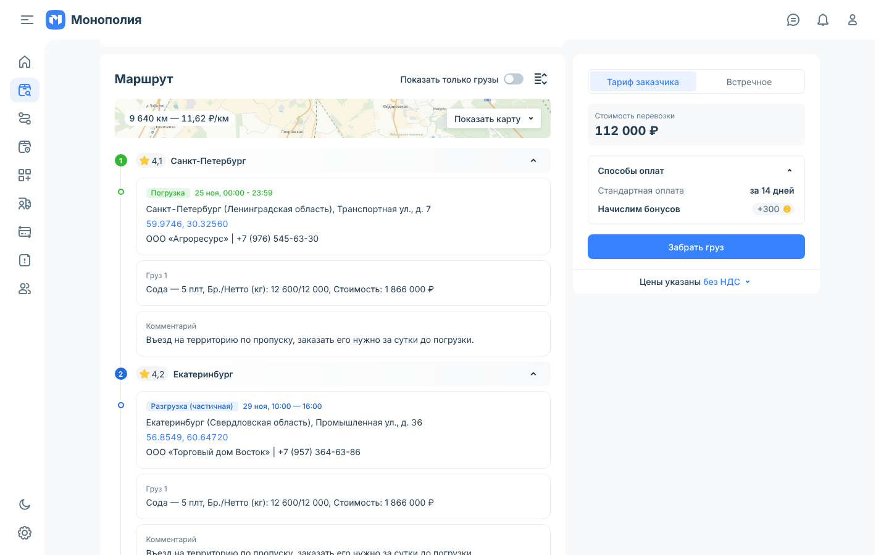
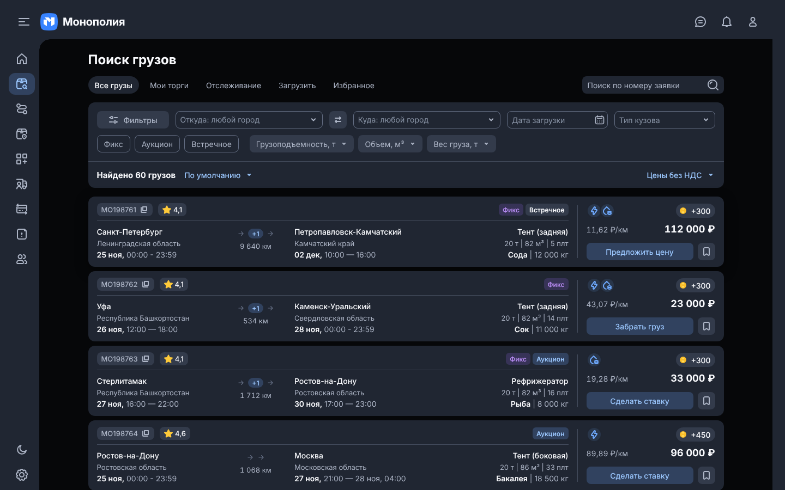
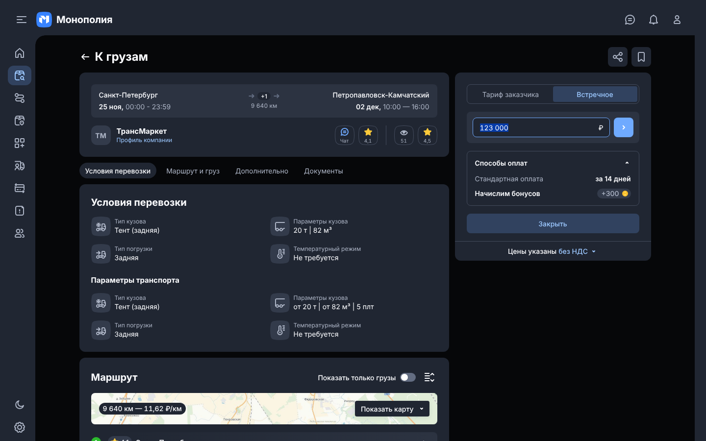

# Монополия — дизайн и прототип «Поиск грузов»

**Посмотреть онлайн:** https://raw.githack.com/neformatno-rgb/superapp/design/monopoly/monopoly-design/index.html  
**Сразу прототип:** https://raw.githack.com/neformatno-rgb/superapp/design/monopoly/monopoly-design/prototype/index.html

## Структура

| Путь | Что внутри |
|---|---|
| `index.html` | Обзорная страница: ссылка на прототип, экраны, галерея иконок. |
| `prototype/index.html` | Кликабельный прототип: список грузов, фильтры, страница перевозки, встречное предложение, светлая/тёмная тема. Один самодостаточный HTML-файл. |
| `tokens/tokens.css` | Цветовые токены светлой и тёмной темы. |
| `assets/icons/` | Все иконки UI-кита отдельными SVG. |
| `assets/` | Логотипы и иллюстрации (топливо, страхование, бонусы, карта маршрута). |
| `docs/screenshots/` | Скриншоты ключевых экранов. |
| `design/canvas/` | Исходники бордов дизайн-канваса Claude (UI-кит, карта цветов, экраны, макет заявки) и `canvas.json`; в `archive/` — ранние экраны (вход по телефону, мобильная и планшетная версии). Это формат канваса — в браузере напрямую не отрисуется. |

## Как это работает

- Клик по карточке открывает полную версию заявки; «← К грузам» или кнопка «Назад» браузера возвращают к списку.
- Типы заявок: «Фикс» → «Забрать груз»; «Фикс + Встречное» → «Предложить цену» (на странице заявки — таймер ожидания ответа 30 минут); «Фикс + Аукцион» и «Аукцион» → «Сделать ставку».
- Тема переключается внизу бокового меню. Номер заявки, адреса и координаты копируются по клику.

## Экраны

| | |
|---|---|
|  |  |
|  |  |

## Локально

Открыть `index.html` или `prototype/index.html` в браузере — сервер не нужен.
